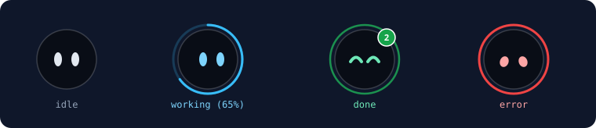

# GrokHead



> **RU**: Плавающий поверх всех окон индикатор статуса фоновых задач и ИИ-агентов для macOS (`working` / `done` / `error`) на чистом AppKit + Core Animation без сторонних зависимостей.  
> **EN**: Lightweight always-on-top floating macOS indicator for background tasks and AI agents (`working` / `done` / `error`), built with pure AppKit + Core Animation and zero external dependencies.

---

## 🇷🇺 Русский

### Что это
**GrokHead** — компактный агент в строке меню macOS (`LSUIElement = YES`, без иконки в Dock). На экране висит круглая голова с живой векторной мимикой глаз (рисуется кодом через `Core Animation`, без картинок):

- **`idle`** — спокойный режим, редкое естественное моргание.
- **`working`** — глаза сканируют влево-вправо, вращается кольцо (или заполняется прогресс `0…1`), снизу пишется название задачи. Если задача не обновлялась дольше *N* минут (по умолчанию 30) — кольцо становится серым (`stale`).
- **`done`** — радостные глаза-дуги `^ ^`, подпрыгивание, звук, зелёный бейдж и системное уведомление; автоматически заменяет `working` с тем же `id`.
- **`error`** — грустная мимика, красное кольцо и отдельный сигнал ошибки.

*(При желании для README можно записать GIF-анимацию экрана в `docs/demo.gif` и заменить ссылку в шапке).*

### Установка из Releases (готовый `GrokHead.app.zip`)
1. Скачайте `GrokHead.app.zip` из раздела **Releases** на GitHub и распакуйте в `/Applications`.
2. Поскольку приложение распространяется без платного сертификата Apple Developer ID, при первом запуске снимите карантин одним из способов:
   - **Правый клик** по `GrokHead.app` → **Открыть** → **Открыть**.
   - Или выполните в Терминале:
     ```bash
     xattr -dr com.apple.quarantine /Applications/GrokHead.app
     open /Applications/GrokHead.app
     ```

### Сборка из исходников (достаточно Command Line Tools, без Xcode)
```bash
git clone https://github.com/zazopro/GrokHead.git
cd GrokHead
bash build_app.sh
open GrokHead.app
```
Скрипт выполняет `swift build -c release` и создаёт как `GrokHead.app`, так и архив `dist/GrokHead.app.zip` для публикации в GitHub Releases.

### Формат файлов и примеры
По умолчанию приложение следит за папкой `~/Downloads/grokhead/` (обработанные файлы переносятся в `archive/` и хранятся 7 дней). Формат имени: `<status>-<unix_ts>.json`:

```json
{"id": "task-123", "title": "Название задачи", "status": "working", "progress": 0.4}
```

Быстрая проверка из Терминала:
```bash
mkdir -p ~/Downloads/grokhead
echo '{"id":"t1","title":"Тест","status":"working"}' > ~/Downloads/grokhead/working-$(date +%s).json
echo '{"id":"t1","title":"Тест","status":"done"}' > ~/Downloads/grokhead/done-$(date +%s).json
```

Вызов из скриптов через URL-схему `grokhead://`:
```bash
open "grokhead://working?id=t1&title=Deploy&progress=0.5"
open "grokhead://done?id=t1&title=Deploy"
open "grokhead://error?id=t1&title=Timeout"
```

### Управление
- **Одиночный клик**: открыть ссылку из настроек (по умолчанию `grokbot://app/v1/`) и сбросить выполненные уведомления.
- **Двойной клик**: отложить звуки и уведомления на 1 час.
- **Правый клик / иконка в строке меню**: список задач, показать/скрыть голову, последние 10 задач, настройки (звуки `.mp3/.m4a/.wav/.aiff`, громкость, «Не беспокоить» по Focus и расписанию, выбор монитора, скрытие при записи экрана, RU/EN), выход.

---

## 🇬🇧 English

### Overview
**GrokHead** is a tiny native macOS menu-bar utility (`LSUIElement = YES`) displaying an always-on-top circular bot head rendered procedurally via `Core Animation`:

- **`idle`** — calm glowing oval eyes with natural periodic blinking.
- **`working`** — eyes scan left-to-right, spinning ring (or `0…1` progress arc), task title label underneath. Turns gray (`stale`) if not updated for *N* minutes (default: 30).
- **`done`** — happy `^ ^` curved eyes, bounce animation, custom/system sound, badge counter, and optional macOS notification; replaces any `working` task with the same `id`.
- **`error`** — sad droopy eyes, red ring, and dedicated error sound.

### Installation from Releases
1. Download `GrokHead.app.zip` from **GitHub Releases** and move `GrokHead.app` to `/Applications`.
2. Because the binary is ad-hoc signed without an Apple Developer ID certificate, bypass Gatekeeper on first launch via **Right-click → Open**, or run:
   ```bash
   xattr -dr com.apple.quarantine /Applications/GrokHead.app
   open /Applications/GrokHead.app
   ```

### Building from Source (Command Line Tools only — no Xcode required)
```bash
bash build_app.sh
open GrokHead.app
```

### File Format & URL Scheme Examples
Drop `<status>-<unix_ts>.json` files into `~/Downloads/grokhead/` (processed files move to `archive/` with automatic 7-day cleanup):

```bash
mkdir -p ~/Downloads/grokhead
echo '{"id":"t1","title":"Test","status":"working"}' > ~/Downloads/grokhead/working-$(date +%s).json
echo '{"id":"t1","title":"Test","status":"done"}' > ~/Downloads/grokhead/done-$(date +%s).json
```

Or trigger directly from shell/Python scripts via URL scheme:
```bash
open "grokhead://working?id=t1&title=Indexing&progress=0.65"
open "grokhead://done?id=t1&title=Indexing"
```

---

## License
Released under the [MIT License](LICENSE).
